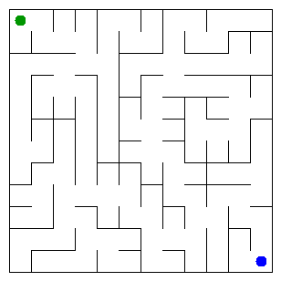

# Assignment 3. Maze Escape

Student ID: 252342
Name: Sandzhar Fazyl
Group: SE-2536
Maze size (rows x columns): 12 x 12

This file is the report. Fill it in as you go. How to start: `START_HERE.md`. The task: `docs/Assignment3.pdf`.

## Program output

The 13 lines your program prints on your data (`java -cp out Main`):

    Broken: 143
    Kept: 121
    Last broken wall: 209
    MST cost: 37283
    Heaviest broken wall: 924
    Path length: 28
    DFS visited: 100
    Dead ends: 43
    Zones: 12
    Largest zone: 19
    Is DAG: 0
    Flow stages: 7
    Fastest route cost: 16

My maze:

## Questions

Answer in your own words, two or three sentences each.

Mission 0. What do find and union do, and what makes them fast in your code?

`find` returns the root of the set containing a cell, and `union` joins two different sets. Path compression makes cells point directly to their root, and union by size attaches the smaller tree under the larger one, keeping future operations fast.

Mission 1. Why is Broken always R*C - 1, and Kept always (R-1)*(C-1)?

The grid starts with R*C separate cells, and every successful union reduces the number of components by one, so connecting all cells breaks R*C - 1 walls. There are R*(C-1) + C*(R-1) inner walls in total; subtracting the broken walls leaves (R-1)*(C-1).

Mission 2. My MST cost from Kruskal and from Prim, and why they are equal:

Kruskal and Prim both give an MST cost of 37283 on my data. They choose edges differently, but both produce a minimum spanning tree of the same connected weighted graph, so their minimum total cost is equal.

Mission 3. Why is there exactly one path between two cells? How did you avoid a stack overflow on a huge maze?

The maze is connected and has no cycles because a wall is broken only when its cells belong to different components. This makes it a tree, with exactly one simple path between any two cells. DFS uses an explicit array stack instead of recursive calls, so a long path does not overflow the Java call stack.

Mission 4. Why does the second pass of Kosaraju go on the reversed graph? Why do the slides have no cycle exactly when Zones equals the number of cells?

The finishing order selects the next source component among the unassigned zones. Reversing the edges prevents the second DFS from following its outgoing slides into other unassigned zones, while cells inside the component remain mutually reachable. Since self-loops are excluded, a directed cycle joins at least two cells into one zone; without cycles, every cell is its own zone, so Zones equals the number of cells.

Mission 5. Why is it enough to go through the zones in the order of their numbers? What does this pass cost?

Kosaraju numbers the zones in topological order, so every edge between zones goes from a smaller number to a larger one. When a zone is processed, all its predecessors have already been processed, allowing both route costs and chain lengths to be updated in one pass. For k zones and q distinct zone edges, this pass takes O(k+q) time; building the graph from m slides takes expected O(k+m) time with the hash maps.

## AI use

The syllabus requires you to say which AI tools you used and for what. Write the tool (ChatGPT, Copilot, other) and what you asked it: explain an idea, find an error, review code. Write "none" if you did not use any. If you took code or text from a book or a website, give the source here.

I used ChatGPT as a reference and assistant to understand algorithms, discuss ideas, plan the work and review.

## Timing (Mission 7)

Milliseconds, 5 runs each, from `java -cp out Bench`. The table contains the rounded averages printed by Bench.

| maze | Kruskal | Prim |
|---|---|---|
| 100 x 100 | 38 | 17 |
| 300 x 300 | 185 | 169 |
| 1000 x 1000 | 2525 | 3406 |

What do the numbers say about how the time grows? Two or three sentences.

Both algorithms take longer as the maze grows: increasing the side length by 10 increases the number of cells by 100. On a grid, the number of walls is proportional to the number of cells, so the sorting and priority-queue operations give roughly O(n log n) growth. Prim was faster for 100 x 100 and 300 x 300, while Kruskal was faster for 1000 x 1000; JVM warm-up, object allocation and garbage collection also affect the measured times.

## Complexity

n is the number of cells, m the number of walls (or slides). Fill in every algorithm you wrote.

| algorithm | time | space | assumptions |
|---|---|---|---|
| DSU find and union | O(alpha(n)) amortized | O(n) for the DSU; O(1) per call | Union by size and iterative path compression; initialization takes O(n) |
| Kruskal | O(m log m) | O(n+m) | Connected grid; sorting wall indexes dominates the DSU operations |
| Prim | O(m log m) | O(n+m) | Adjacency lists and a lazy priority queue of wall indexes |
| DFS | O(n+m) | O(n+m) | Includes building open adjacency lists; at most four neighbours per cell; explicit stack |
| Kosaraju | O(n+m) | O(n+m) | Two iterative DFS passes and forward/reversed adjacency lists |
| Route in the zone graph | O(k+m) expected, including graph construction; O(k+q) for the DP pass | O(k+q) additional space | k zones, q distinct zone edges; expected O(1) hash-map operations; topological zone numbering |

For a grid, m = O(n), so both MST implementations have O(n log n) time complexity. Here alpha(n) is the inverse Ackermann function, which grows extremely slowly. For the route algorithm, the supplied zoneOf array uses O(n) space in addition to the graph and DP arrays.

## Before you submit

- data/walls.txt, data/slides.txt and output/maze.png are in the repository.
- `java tools/Check.java` shows all examples right.
- This README is filled in, the program output and the section AI use included.
- The work is pushed to main (at least one commit per mission) and the repository is public.
- The link is attached in Moodle.
